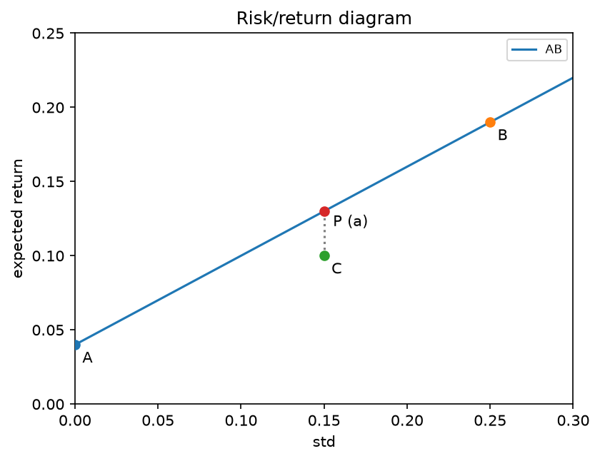
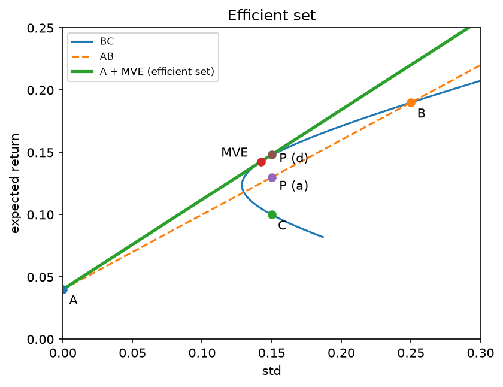

his problem set is due before class Week 3. You are to submit solutions to the assignment using Canvas. You may work on this in groups of your choosing. Groups may be of no more than 5 people. Submit one solution for each group following the instructions on Canvas.

## Q1

Obtain the data file `ps2_problem1.xlsx` from Canvas. In this file, the first column contains the date. Subsequent columns contain the returns to the: a) Value Weighted ("Market") index of exchange listed stocks, b) Target, c) Tesla, and d) Alphabet common stocks. In all cases, the return is the simple return (one month) over the period from the previous date up to the date in column 1. (Note: the return for the first row (date 30JULY2010) is from 06/30/2010 to 07/30/2010.)

**(a) Find the average returns on the Market and each of the three stocks over the entire period from July 30, 2010 through the end of 2025.**

|          | Average return |
|----------|----------------|
| Market   | 0.0115         |
| Target   | 0.0091         |
| Tesla    | 0.0453         |
| Alphabet | 0.0207         |

**(b) Find the variance of each of these returns over the entire period.**

|          | Variance of returns |
|----------|---------------------|
| Market   | 0.00175             |
| Target   | 0.0062              |
| Tesla    | 0.0330              |
| Alphabet | 0.0052              |

**(c) Calculate the covariance between the return on Target and the return on Tesla. Calculate the covariance between the return on Target and the return on Alphabet. Calculate the covariance between the return on Tesla and the return on Alphabet.**

|              | Target | Tesla  | Alphabet |
|--------------|--------|--------|----------|
| **Target**   | 0.0061 | 0.0028 | 0.0013   |
| **Tesla**    | 0.0028 | 0.0329 | 0.0031   |
| **Alphabet** | 0.0013 | 0.0032 | 0.0052   |

: Covariance matrix

**(d) Consider the following two portfolios:**

- Portfolio A had 60% invested in Target, 20% in Tesla and 20% in Alphabet at the beginning of each month.

- Portfolio B had 60% invested in Tesla, 20% in Target and 20% in Alphabet at the beginning of each month.

**i. Using just the average returns and variances of the three stocks, plus the covariances between the stocks (calculated in parts a, b and c), calculate the average returns and variances of these two portfolios, and the covariance between the two portfolios.**
  
  For average returns:

$$\bar r_A = 0.6(0.009103) + 0.2(0.045293) + 0.2(0.020687) = 0.018658$$

$$\bar r_B = 0.2(0.009103) + 0.6(0.045293) + 0.2(0.020687) = 0.033134$$

For the variance of the three assets:
$$
\begin{aligned}
\sigma_A^2 &= 0.6^2(0.006172) + 0.2^2(0.032999) + 0.2^2(0.005217) \\
&\quad + 2(0.6)(0.2)(0.002829) + 2(0.6)(0.2)(0.001314) + 2(0.2)(0.2)(0.003194) \\
&= 0.005000
\end{aligned}
$$

$$
\begin{aligned}
\sigma_B^2 &= 0.2^2(0.006172) + 0.6^2(0.032999) + 0.2^2(0.005217) \\
&\quad + 2(0.2)(0.6)(0.002829) + 2(0.2)(0.2)(0.001314) + 2(0.6)(0.2)(0.003194) \\
&= 0.013886
\end{aligned}
$$

|                        | Portfolio A | Portfolio B |
|------------------------|-------------|-------------|
| **Average return**     | 0.018658    | 0.033134    |
| **Variance**           | 0.005000    | 0.013886    |

Now, to get the covariance:

$$
\begin{aligned}
\text{Cov}(r_A, r_B) &= (0.6)(0.2)(0.006172) + (0.2)(0.6)(0.032999) + (0.2)(0.2)(0.005217) \\
&\quad + \left[(0.6)(0.6) + (0.2)(0.2)\right](0.002829) \\
&\quad + \left[(0.6)(0.2) + (0.2)(0.2)\right](0.001314) \\
&\quad + \left[(0.2)(0.2) + (0.6)(0.2)\right](0.003194) \\
&= 0.12(0.006172) + 0.12(0.032999) + 0.04(0.005217) \\
&\quad + 0.40(0.002829) + 0.16(0.001314) + 0.16(0.003194) \\
&= 0.006762
\end{aligned}
$$

**ii. Now on a spreadsheet calculate the realized returns of each of the portfolios for each month. Using these realized returns calculate the portfolio average returns, variances and the covariance directly, confirming your answers from above.**

They are indeed the same!

## Q2

The Triad family of mutual funds allows investors to split their money between several portfolios managed by Triad.

| Portfolio | Description                   | Expected return | Standard deviation |
|------------------|-------------------|------------------|------------------|
| A         | Entirely risk-free securities | 4% (certain)    | 0%                 |
| B         | Risky                         | 19%             | 25%                |
| C         | Risky                         | 10%             | 15%                |

Your client is leaning towards investing his money entirely in portfolio C, since he is unwilling to take the higher risk associated with portfolio B, but wants a higher return than offered by portfolio A.

**(a) In your role as a Triad investment advisor, you suggest to him an alternative portfolio (consisting of a combination of A and B) that has the same standard deviation as portfolio C but a higher expected return. If he has \$200,000 to invest, how much should he invest in B and how much in A? What is his expected return in this case? (Note that since you work for Triad you cannot recommend investing in a market index fund, since this is not sold by Triad.)**

Because A is risk-free, the standard deviation of the combination is

\$$\sigma_p = w_B \, \sigma_B$.

To match the risk of C:

$$w_B = \frac{\sigma_C}{\sigma_B} = \frac{0.15}{0.25} = 0.60, \qquad w_A = 0.40$$

|                 | Weight | Investment |
|-----------------|--------|------------|
| **Portfolio B** | 60%    | \$120,000  |
| **Portfolio A** | 40%    | \$80,000   |
| **Total**       | 100%   | \$200,000  |

$$E(r_p) = 0.04 + 0.60\,(0.19 - 0.04) = 13.00\%, \qquad \sigma_p = 15\%$$

The client has the same risk as in portfolio C, but his expected return increases from 10% to 13%.

**(b) Sketch a risk/return diagram to help explain to him why his combination of risk and return is improved by this option, and why his risk has not increased. Show all four portfolios on the diagram (the original three plus your suggestion).**

All combinations of A and B are on a straight line (the capital allocation line), with slope equal to $SR_B = 0.60$. Portfolio C is below this line, because its Sharpe ratio is only 0.40. The suggested portfolio P is on the line, directly above C. It has the same standard deviation (15%), so the risk did not increase. Only the expected return increased.

**(c) Now assume that the correlation between portfolios B and C is 0. Find the combination of B and C that is mean-variance efficient. That is, find the "MVE" portfolio that combines these two portfolios. Calculate and report the portfolio weights in the MVE portfolio. Also calculate the expected return and standard deviation of the MVE portfolio. What is the Sharpe ratio of the MVE portfolio? How does this compare to the Sharpe ratio for portfolios B and C?**

When $\rho_{B,C} = 0$, each MVE weight is proportional to the asset's excess return divided by its variance:

$$\frac{E_B - r_f}{\sigma_B^2} = \frac{0.15}{0.0625} = 2.40, \qquad \frac{E_C - r_f}{\sigma_C^2} = \frac{0.06}{0.0225} = 2.67$$

$$w_B = \frac{2.40}{2.40 + 2.67} = 0.4737, \qquad w_C = 0.5263$$

|                        | MVE portfolio |
|------------------------|---------------|
| **Weight in B**        | 47.37%        |
| **Weight in C**        | 52.63%        |
| **Expected return**    | 14.26%        |
| **Standard deviation** | 14.23%        |
| **Sharpe ratio**       | 0.721         |

$$\sigma_{MVE} = \sqrt{0.4737^2(0.0625) + 0.5263^2(0.0225)} = 14.23\%, \qquad SR_{MVE} = \frac{0.1426 - 0.04}{0.1423} = 0.721$$

The Sharpe ratio of the MVE portfolio (0.721) is higher than that of B (0.60) and that of C (0.40). Because B and C are uncorrelated, the combination decreases risk more than it decreases expected return. As a check, with zero correlation $SR_{MVE} = \sqrt{SR_B^2 + SR_C^2} = \sqrt{0.36 + 0.16} = 0.721$.

**(d) Using the "MVE" portfolio and portfolio A, find a portfolio that has the same standard deviation as portfolio C but has higher expected return. What amount of money would be invested in each of the securities A, B and C to achieve this return? How does the expected return of this portfolio compare with the expected return of the portfolio you constructed in part 1a? Why is it different?**

$$w_{MVE} = \frac{\sigma_C}{\sigma_{MVE}} = \frac{0.15}{0.1423} = 1.0539, \qquad w_A = -0.0539$$

|                 | Weight                   | Investment           |
|-----------------|--------------------------|----------------------|
| **Portfolio B** | 1.0539 × 0.4737 = 49.92% | 99,846             |
| **Portfolio C** | 1.0539 × 0.5263 = 55.47% | 110,940            |
| **Portfolio A** | -5.39%                   | 10,786 (borrowed) |
| **Total**       | 100%                     | 200,000            |

Because $\sigma_{MVE} < \sigma_C$, the client must borrow a small amount at the risk-free rate to reach a standard deviation of 15%.

$$E(r_p) = 0.04 + 1.0539\,(0.1426 - 0.04) = 14.82\%, \qquad \sigma_p = 15\%$$

The expected return is 14.82%, compared with 13.00% in part (a), at the same risk. The difference is that the MVE portfolio has a higher Sharpe ratio than B (0.721 vs. 0.60), so its capital allocation line is steeper. Diversification between B and C gives more expected return for each unit of risk.

**(e) Draw a diagram that shows how considering all possible combinations of investments in the available portfolios improves the set of risk and return choices. Indicate the set of combinations that investors should prefer (e.g., those which minimize risk for a given level of return).**

The curve shows all combinations of B and C. The dashed line is the original capital allocation line through B. The thick line is the new capital allocation line through the MVE portfolio, which touches the curve at the MVE. The efficient set is the new capital allocation line For each level of risk, it gives the highest expected return, and for each level of expected return, it gives the lowest risk. All other portfolios (A-B combinations, C, and the B-C curve) are below it, except the MVE itself. Each investor chooses a point on this line based on how much risk they accept.

## Q3

Consider the following assumptions about annual returns to two stock mutual funds "A" and "B":

| Fund | $E(r)$ | $\sigma$ |
|------|--------|----------|
| A    | 8%     | 20%      |
| B    | 12%    | 30%      |

$$\rho_{A,B} = 0.2$$

In addition, a one-year T-Bill offers a risk-free return of 2%.

**(a) You have \$1 million to invest. Although we know that diversification is important, let's consider investments in just one risky security along with the T-Bill. Suppose that you have a target expected rate of return of 10% for your portfolio.**

1.  **How could you achieve this target by investing in the T-Bill and mutual fund A? What percentage and dollar investment would be in the T-Bill and in the mutual fund? What is the standard deviation of your portfolio return? What is the Sharpe ratio of your portfolio? How does this compare to the Sharpe ratio of mutual fund A?**

$$0.02 + w_A\,(0.08 - 0.02) = 0.10 \;\Rightarrow\; w_A = \frac{0.08}{0.06} = 1.333$$

|            | Weight  | Investment            |
|------------|---------|-----------------------|
| **Fund A** | 133.33% | 1,333,333           |
| **T-Bill** | -33.33% | -333,333 (borrowed) |
| **Total**  | 100%    | 1,000,000           |

$$\sigma_p = 1.333 \times 0.20 = 26.67\%, \qquad SR_p = \frac{0.10 - 0.02}{0.2667} = 0.30$$

Fund A alone returns only 8%, so you must borrow at the T-Bill rate to reach 10%. The Sharpe ratio of the portfolio (0.30) is equal to the Sharpe ratio of fund A. Any mix of one risky asset and the risk-free asset is on the same capital allocation line, so it has the same Sharpe ratio.

**2. Instead, how could you achieve the target by investing in the T-Bill and mutual fund B? What percentage and dollar investment would be in the T-Bill and in the mutual fund? What is the standard deviation of your portfolio return? What is the Sharpe ratio of your investment? How does this compare to the Sharpe ratio of mutual fund B?** 

$$0.02 + w_B\,(0.12 - 0.02) = 0.10 \;\Rightarrow\; w_B = \frac{0.08}{0.10} = 0.80$$

|            | Weight | Investment  |
|------------|--------|-------------|
| **Fund B** | 80%    | \$800,000   |
| **T-Bill** | 20%    | \$200,000   |
| **Total**  | 100%   | \$1,000,000 |

$$\sigma_p = 0.80 \times 0.30 = 24.00\%, \qquad SR_p = \frac{0.10 - 0.02}{0.24} = 0.333$$

The Sharpe ratio of the portfolio (0.333) is equal to the Sharpe ratio of fund B, for the same reason as in (i).

**(b) Both of the portfolios above achieve an expected return of 10%. Which is preferred? Why?**

The portfolio with fund B is preferred. Both portfolios have an expected return of 10%, but the portfolio with B has a lower standard deviation (24.00% vs. 26.67%). This is because fund B has a higher Sharpe ratio (0.333 vs. 0.30): its capital allocation line is steeper, so it gives more expected return for each unit of risk. Although fund B alone is riskier than fund A, what matters is the risk of the full portfolio.

**(c) Suppose now that you can invest in a combination of the T-Bill, mutual fund A and mutual fund B. Once again your objective is to achieve an expected return of 10%. How would you invest your money? Be specific (percentage investments and dollar investments please). What is the Sharpe ratio of your portfolio? How does it compare to the Sharpe ratios of mutual funds A and B?**

First of all, I would take a look at the MVE portfolio of A and B. With $\text{cov}(r_A, r_B) = 0.2 \times 0.20 \times 0.30 = 0.012$:

$$w_A^{MVE} = \frac{(E_A - r_f)\,\sigma_B^2 - (E_B - r_f)\,\sigma_{AB}}{(E_A - r_f)\,\sigma_B^2 + (E_B - r_f)\,\sigma_A^2 - (E_A - r_f + E_B - r_f)\,\sigma_{AB}} = \frac{0.0054 - 0.0012}{0.0054 + 0.0040 - 0.00192} = 0.5615$$

$$w_B^{MVE} = 1 - 0.5615 = 0.4385$$

|                        | MVE portfolio |
|------------------------|---------------|
| **Weight in A**        | 56.15%        |
| **Weight in B**        | 43.85%        |
| **Expected return**    | 9.75%         |
| **Standard deviation** | 18.93%        |
| **Sharpe ratio**       | 0.410         |

$$\sigma_{MVE} = \sqrt{0.5615^2(0.04) + 0.4385^2(0.09) + 2(0.5615)(0.4385)(0.012)} = 18.93\%$$

After that, mix the MVE and the T-Bill to reach 10%:

$$0.02 + w\,(0.0975 - 0.02) = 0.10 \;\Rightarrow\; w = 1.0317$$

|            | Weight                   | Investment           |
|------------|--------------------------|----------------------|
| **Fund A** | 1.0317 × 0.5615 = 57.93% | \$579,310            |
| **Fund B** | 1.0317 × 0.4385 = 45.24% | \$452,414            |
| **T-Bill** | -3.17%                   | -\$31,724 (borrowed) |
| **Total**  | 100%                     | \$1,000,000          |

$$\sigma_p = 1.0317 \times 0.1893 = 19.53\%, \qquad SR_p = \frac{0.10 - 0.02}{0.1953} = 0.410$$

The Sharpe ratio of this portfolio (0.410) is higher than that of fund A (0.30) and that of fund B (0.333). For the same 10% expected return, the standard deviation decreases to 19.53%, compared with 26.67% in (a)(i) and 24.00% in (a)(ii). Because A and B are not perfectly correlated ($\rho = 0.2$), combining them decreases risk more than it decreases expected return. Then the T-Bill sets the level of risk.