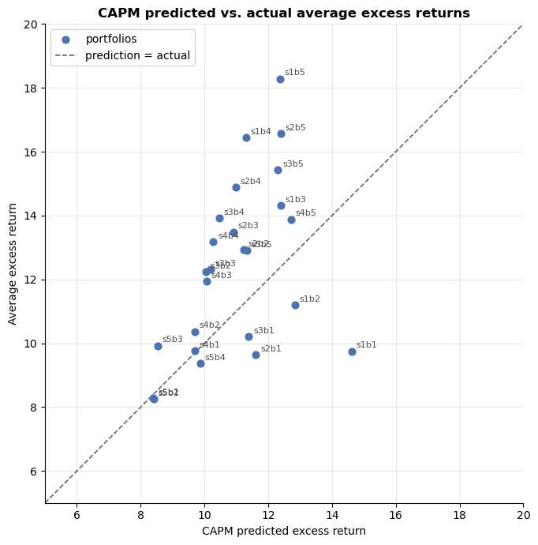
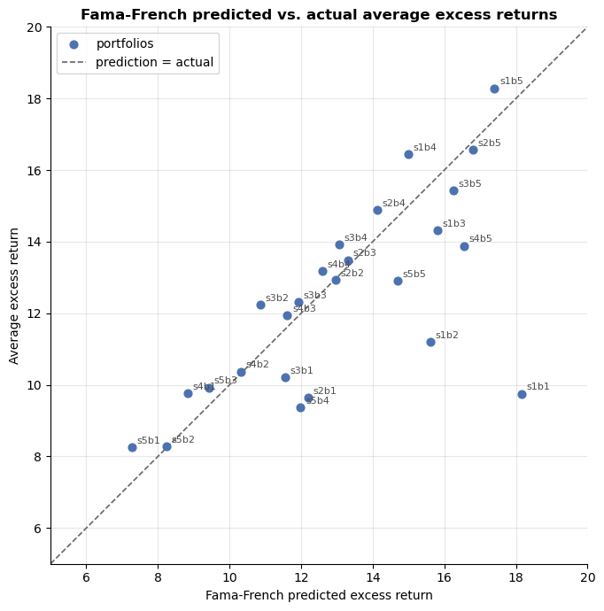

# Q1

For this exercise you are to use the data in the file `ps4_FFData.xlsx`. The spreadsheet has several sheets. The first one provides monthly returns on the three Fama-French factors: the excess return on the market, SMB and HML. The second sheet provides returns on 25 portfolios sorted by market cap and book-to-market values of equity.

After you have the data, do the following:

> **PLEASE NOTE:** As you construct tables in response to the questions below about each of the 25 portfolios, please format the tables as in the work by Fama and French: 5 rows for the size splits from small-cap to large-cap and 5 columns for the B/M splits from low to high (value to growth). **NOTE:** the table formatting is given at the end of this document.

**(a)** Fill in Tables 1 and 2 at the end of the document. For each of the 25 portfolio returns estimate the "CAPM" $\alpha$'s and $\beta$'s. For each portfolio $i$ run the regression:

$$
r_{i,t} - r_{f,t} = \alpha_i + \beta_i \left( r_{m,t} - r_{f,t} \right) + \epsilon_{i,t}
$$

I understand that the CAPM would impose $\alpha = 0$. Estimate the $\alpha$'s unrestricted, and then annualize them (multiply by 12) and express them in percent (multiply by 100).

*NOTE:* $r_{m,t} - r_{f,t}$ is the first Fama-French factor `mktrf` in the `ff_factors` sheet. To construct $r_{i,t} - r_{f,t}$ for each portfolio you will need to subtract the risk-free return from returns given in the `ff_portfolios25` sheet. The risk-free rate for each date is given by the column `rf` in the `ff_factors` sheet.

*NOTE:* There are 25 regressions here. You only need to run 5 of these regressions, since the results for the 20 remaining regressions are already provided for you in Tables 1 and 2 below.

*NOTE:* To match the alphas in Table 2, you need to annualize the alphas you obtain from the time-series regressions (multiply by 12) and express them in percent (multiply by 100).

Report the $\alpha$'s and $\beta$'s for the portfolios in two tables: one for the $\alpha$'s and one for the $\beta$'s. Please format the tables as described above. Do you notice any patterns? What is your sense of how the CAPM does in describing this data?

**Table 1: Estimated CAPM** $\beta$'s

| Size  Book-Market | Low  |  2   |  3   |  4   | High |
|:------------------|:----:|:----:|:----:|:----:|:----:|
| **Small**         | 1.65 | 1.44 | 1.40 | 1.27 | 1.39 |
| **2**             | 1.31 | 1.26 | 1.23 | 1.24 | 1.39 |
| **3**             | 1.28 | 1.13 | 1.15 | 1.18 | 1.38 |
| **4**             | 1.09 | 1.09 | 1.13 | 1.16 | 1.43 |
| **Big**           | 0.95 | 0.94 | 0.96 | 1.11 | 1.28 |

Moving from small to larger firms, the $\beta$'s are lower. And moving from low to high B/M, $\beta$'s are more assymetrical.

**Table 2: Estimated CAPM** $\alpha$'s

| Size  Book-Market |  Low  |   2   |  3   |   4   | High |
|:------------------|:-----:|:-----:|:----:|:-----:|:----:|
| **Small**         | -4.88 | -1.62 | 1.92 | 5.14  | 5.91 |
| **2**             | -1.98 | 1.71  | 2.58 | 3.89  | 4.18 |
| **3**             | -1.17 | 2.20  | 2.12 | 3.45  | 3.12 |
| **4**             | 0.07  | 0.68  | 1.86 | 2.90  | 1.17 |
| **Big**           | -0.16 | -0.11 | 1.39 | -0.52 | 1.58 |

In the case of $\alpha$'s, moving from low to high B/M, tends to increase. Moving from small to large firms, same case.

**(b)** Next, for each of the 25 portfolio returns, estimate the average excess returns using sample averages. Annualize them (multiply by 12) and report these in percent (multiply by 100). Report your answers.

**Average excess returns**

| Size  Book-Market |  Low  |   2   |   3   |   4   | High  |
|:------------------|:-----:|:-----:|:-----:|:-----:|:-----:|
| **Small**         | 9.75  | 11.21 | 14.32 | 16.44 | 18.29 |
| **2**             | 9.63  | 12.93 | 13.49 | 14.88 | 16.57 |
| **3**             | 10.22 | 12.24 | 12.32 | 13.92 | 15.42 |
| **4**             | 9.76  | 10.37 | 11.93 | 13.18 | 13.88 |
| **Big**           | 8.26  | 8.29  | 9.93  | 9.36  | 12.91 |

**(c)** Estimate the average excess return on the market using the data. Using this estimate and the betas from part 1(a), calculate the expected excess returns to holding each portfolio based on the CAPM (imposing $\alpha_i = 0$). Annualize them (multiply by 12) and report these in percent (multiply by 100). Report your answers.

**Average excess returns on the market**

| Size  Book-Market |  Low  |   2   |   3   |   4   | High  |
|:------------------|:-----:|:-----:|:-----:|:-----:|:-----:|
| **Small**         | 14.63 | 12.83 | 12.40 | 11.30 | 12.38 |
| **2**             | 11.61 | 11.22 | 10.91 | 10.99 | 12.40 |
| **3**             | 11.39 | 10.03 | 10.20 | 10.46 | 12.31 |
| **4**             | 9.69  | 9.69  | 10.08 | 10.28 | 12.71 |
| **Big**           | 8.42  | 8.40  | 8.54  | 9.88  | 11.33 |

In a single graph, plot these predictions across portfolios compared to the observed average excess returns to holding the portfolios. What patterns do you see?

If the CAPM held, all 25 points would be strictly positively correlated. CAPM predicted was higher that actual average returns.

{width="500"}

# Q2

Repeat parts (a) and (c) of the above exercise, except now use a three-factor model. In this model there are multiple betas. Run a time-series regression of each portfolio return on the three factors available from Kenneth French's web page. In other words, for each portfolio estimate:

$$
r_{i,t} - r_{f,t} = \alpha_i + \beta_i^{m} f_{m,t} + \beta_i^{smb} f_{smb,t} + \beta_i^{hml} f_{hml,t} + \epsilon_{i,t}
$$

where $f_{m,t} = r_{m,t} - r_{f,t}$ is the excess return on the market portfolio (the first Fama-French factor `mktrl` in the spreadsheet), $f_{hml,t} = r_{hml,t}$ is the observed HML factor in period $t$ (the second Fama-French factor `smb` in the spreadsheet), and $f_{smb,t} = r_{smb,t}$ is the observed SMB factor in period $t$ (the third Fama-French factor `hml` in the spreadsheet).

Fill in Tables 3, 4, 5 and 6 below. Report the estimated $\alpha$'s and (multiple) $\beta$'s for each portfolio.

*NOTE:* As with the CAPM regressions there are 25 regressions here. You don't need to do all of these since the results for 20 of these regressions are provided for you in Tables 3, 4, 5 and 6 below.

*NOTE:* To match the alphas in Table 6, you need to annualize the alphas you obtain from the time-series regressions (multiply by 12) and express them in percent (multiply by 100).

**Table 3: Estimated** $\beta^{Mkt}$

| Size  Book-Market | Low  |  2   |  3   |  4   | High |
|:------------------|:----:|:----:|:----:|:----:|:----:|
| **Small**         | 1.25 | 1.08 | 1.06 | 0.92 | 0.97 |
| **2**             | 1.10 | 1.03 | 0.99 | 0.98 | 1.07 |
| **3**             | 1.14 | 1.01 | 1.01 | 0.99 | 1.12 |
| **4**             | 1.07 | 1.03 | 1.04 | 1.03 | 1.22 |
| **Big**           | 1.02 | 0.99 | 0.97 | 1.05 | 1.16 |

**Table 4: Estimated** $\beta^{SMB}$

| Size  Book-Market |  Low  |   2   |   3   |   4   | High  |
|:------------------|:-----:|:-----:|:-----:|:-----:|:-----:|
| **Small**         | 1.50  | 1.54  | 1.21  | 1.24  | 1.32  |
| **2**             | 1.14  | 0.97  | 0.82  | 0.81  | 0.90  |
| **3**             | 0.82  | 0.51  | 0.43  | 0.46  | 0.60  |
| **4**             | 0.33  | 0.21  | 0.20  | 0.21  | 0.32  |
| **Big**           | -0.15 | -0.20 | -0.25 | -0.18 | -0.16 |

**Table 5: Estimated** $\beta^{HML}$

| Size  Book-Market |  Low  |  2   |  3   |  4   | High |
|:------------------|:-----:|:----:|:----:|:----:|:----:|
| **Small**         | 0.44  | 0.22 | 0.5  | 0.57 | 0.91 |
| **2**             | -0.24 | 0.14 | 0.37 | 0.57 | 0.89 |
| **3**             | -0.24 | 0.04 | 0.32 | 0.55 | 0.87 |
| **4**             | -0.35 | 0.09 | 0.35 | 0.56 | 0.94 |
| **Big**           | -0.26 | 0.03 | 0.33 | 0.64 | 0.98 |

**Table 6: Estimated Multifactor** $\alpha$'s

| Size  Book-Market |  Low  |   2   |   3   |   4   | High  |
|:------------------|:-----:|:-----:|:-----:|:-----:|:-----:|
| **Small**         | -8.42 | -4.4  | -1.48 | 1.45  | 0.88  |
| **2**             | -2.56 | -0.04 | 0.18  | 0.76  | -0.22 |
| **3**             | -1.33 | 1.39  | 0.41  | 0.86  | -0.84 |
| **4**             | 0.93  | 0.06  | 0.32  | 0.58  | -2.66 |
| **Big**           | 0.98  | 0.06  | 0.51  | -2.63 | -1.78 |

Estimate the average excess return on the market, the average return of the SMB factor, and the average return of the HML factor. Use these estimates together with the beta estimates and calculate the excess returns to holding each portfolio based on the 3-factor model (imposing $\alpha_i = 0$):

$$
\mathbb{E}\left[ r_i - r_f \right] = \beta_i^{m} \, \bar{f}_m + \beta_i^{smb} \, \bar{f}_{smb} + \beta_i^{hml} \, \bar{f}_{hml}
$$

Annualize them (multiply by 12) and express them in percent (multiply by 100). Plot these predicted excess returns against the observed average excess returns for the portfolios (which you computed in Question 1(b)). How does this figure compare to the similar figure from Question 1?

Prediction is more accurate! At least on average.

# Q3

For this question you are to use the data in the spreadsheet `ps4_question3.xlsx`. This provides quarterly data on the returns to three portfolios: the market portfolio, a portfolio of small-cap stocks, and a portfolio of value stocks. The data runs from the first quarter of 2008 until the second quarter of 2018. The returns have been annualized.

**(a)** Estimate the means, variances and covariances of the returns and then use the spreadsheet `eff3.xls` to calculate the implied MVE portfolio that combines these portfolios to provide the portfolio with the highest Sharpe ratio. Alternatively, use the Excel sheet called `Solver.xlsx` to use Solver to calculate the weights. Assume that the risk-free rate is 2%. Do the weights you obtain look reasonable to you? Would you use these to construct a suggested MVE portfolio today?

|           | Market | Small Cap | Value  |
|:----------|:------:|:---------:|:------:|
| Mean      | 0.0986 |  0.1192   | 0.1155 |
| Std. dev. | 0.3271 |  0.4159   | 0.3537 |
| Variance  | 0.1070 |  0.1730   | 0.1251 |

|           | Market | Small Cap | Value  |
|:----------|:------:|:---------:|:------:|
| Market    | 0.1070 |  0.1288   | 0.1119 |
| Small Cap | 0.1288 |  0.1730   | 0.1396 |
| Value     | 0.1119 |  0.1396   | 0.1251 |

The three portfolios are almost perfectly correlated: the pairwise correlations are 0.9469 (Market–Small), 0.9676 (Market–Value) and 0.9486 (Small–Value).

|                 | Market  | Small Cap | Value  |  MVE   |
|:----------------|:-------:|:---------:|:------:|:------:|
| MVE weight      | -1.2594 |  -0.3156  | 2.5750 | 1.0000 |
| Expected return | 0.0986  |  0.1192   | 0.1155 | 0.1355 |
| Std. dev.       | 0.3271  |  0.4159   | 0.3537 | 0.4074 |
| Sharpe ratio    | 0.2402  |  0.2385   | 0.2699 | 0.2836 |

Do the weights don't look reasonable. The MVE portfolio shorts the market (-126%) and small caps (-32%) and puts 258% of its value in the value portfolio. The reason is the near-perfect correlation between the asset.

The payoff from these extreme positions is small. The MVE Sharpe ratio of 0.2836 is only about 0.014 higher than holding the value portfolio alone (0.2699).

That said, I would not use this portfolio.

**(b)** Discuss at least one constraint you might want to apply to the analysis in (a). (If you want, feel free to apply this constraint in the Excel sheet `Solver.xlsx` — although doing so is not necessary.) What are the advantages/disadvantages of applying such constraints?

A natural constraint is to require every weight to lie between 0 and 1, $0 \le w_i \le 1$ This rules out the short positions in Market and Small Cap that the unconstrained solution relies on.